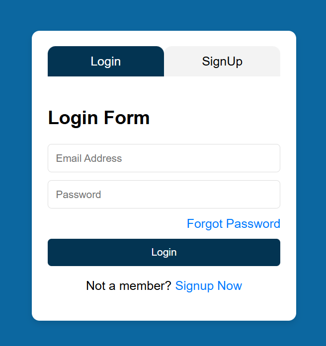

# React Login & Signup Form

A simple and interactive Login and Signup Form built using **React.js** and **CSS**.

## 📸 Screenshot



## ✨ Features

- Toggle between Login and Signup forms.
- Active tab highlighting.
- Switch to Signup directly from the Login form.
- Simple and clean UI.
- React `useState` hook for managing form toggling.

## 🛠️ Technologies Used

- React.js
- JavaScript
- CSS
- Vite

## 🚀 Getting Started

1. Clone the repository:
   ```bash
   git clone <your-repository-link>
   ```

2. Navigate to the project folder:
   ```bash
   cd <project-folder>
   ```

3. Install dependencies:
   ```bash
   npm install
   ```

4. Start the development server:
   ```bash
   npm run dev
   ```

## 📚 Learning Reference

This project was built with the help of the following YouTube tutorial:

[Add YouTube Tutorial Link Here](https://www.youtube.com/watch?v=vWcyisPuTOA&list=PLp18NAIKHWnvpLpioGs6ZAiMlpfx49KOz&index=36&t=99s)

